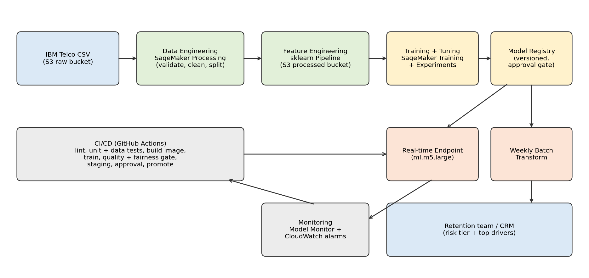

# Customer Churn Prediction (AAI-540 MLOps Project)

Supervised binary classification model that identifies customers at highest risk of cancelling a
subscription, built as an end-to-end ML system on AWS SageMaker.

**Team:** Rajneesh Kumar, Vinitha Palani, Balaram Sahu
**Data:** Kaggle Customer Churn Dataset (training and testing files), stored in S3 (see `data/README.md`)

## Architecture

## Repository layout

| Path | Purpose |
|---|---|
| `notebooks/01_data_ingestion_athena.ipynb` | Upload raw data to S3, create Athena tables, validate data |
| `notebooks/02_eda.ipynb` | Exploratory data analysis (charts saved to `docs/figures/`) |
| `notebooks/03_cleaning_features_feature_store.ipynb` | Cleaning, feature engineering, 80/20 split, SageMaker Feature Store |
| `notebooks/04_model_training_evaluation.ipynb` | Benchmark, model comparison, tuning, threshold, test evaluation, fairness, SageMaker Training job |
| `notebooks/05_registry_and_deployment.ipynb` | Model Registry, real-time endpoint with data capture, batch transform |
| `notebooks/06_monitoring.ipynb` | Data, model, and infrastructure monitors; drift report; CloudWatch dashboard |
| `notebooks/07_cicd_pipeline.ipynb` | SageMaker Pipeline (success and failed runs), approvals, GitHub Actions notes |
| `src/` | Shared code: `config.py`, `data_utils.py`, `preprocessing.py`, `features.py`, `modeling.py`, `monitoring.py` |
| `scripts/` | SageMaker entry points: `preprocess.py`, `train.py`, `evaluate.py`, `inference.py` |
| `pipelines/` | Pipeline definition (`pipeline.py`) and runner (`run_pipeline.py`) |
| `tests/` | Unit tests for cleaning, features, modeling, and drift |
| `.github/workflows/` | `ci.yml` (lint and tests on pull requests) and `cd.yml` (run the pipeline on merge to main) |
| `data/README.md` | Where the data lives in S3 and how to reproduce it |
| `docs/` | Architecture diagram and figures |

## How to run

1. Clone into a SageMaker Studio or notebook-instance environment and `pip install -r requirements.txt`.
2. Download the two Kaggle CSV files into `data/local/` (git-ignored, never committed).
3. Run the notebooks in order, 01 to 07. The S3 bucket defaults to the SageMaker default bucket; set `CHURN_BUCKET` to override it.
4. Run the unit tests locally with `python -m pytest tests`.

Add `data/local/` and `.pipeline_build/` to `.gitignore`.

## Key design decisions

- **Split:** stratified 80/20 train/test of the training file; tuning and the decision threshold use cross-validation inside the training split; the Kaggle testing file is held out as unseen "production" data.
- **Fairness:** Gender is excluded from the model; Gender and Age bands are audited, and gaps above the limit block promotion in the pipeline.
- **Threshold:** chosen from business cost (placeholder costs in `src/config.py`), not 0.5.
- **Quality gate:** ROC-AUC, recall, and fairness gaps must pass before a model is registered.

## Status

| Stage | Notebook | Status |
|---|---|---|
| Ingestion and Athena | 01 | Written |
| EDA | 02 | Written |
| Cleaning and feature store | 03 | Written |
| Training and evaluation | 04 | Written |
| Registry and deployment | 05 | Written |
| Monitoring | 06 | Written |
| CI/CD | 07 | Written |

"Written" means the code is in place; update this table as each notebook is run in SageMaker.

## License

Apache-2.0
